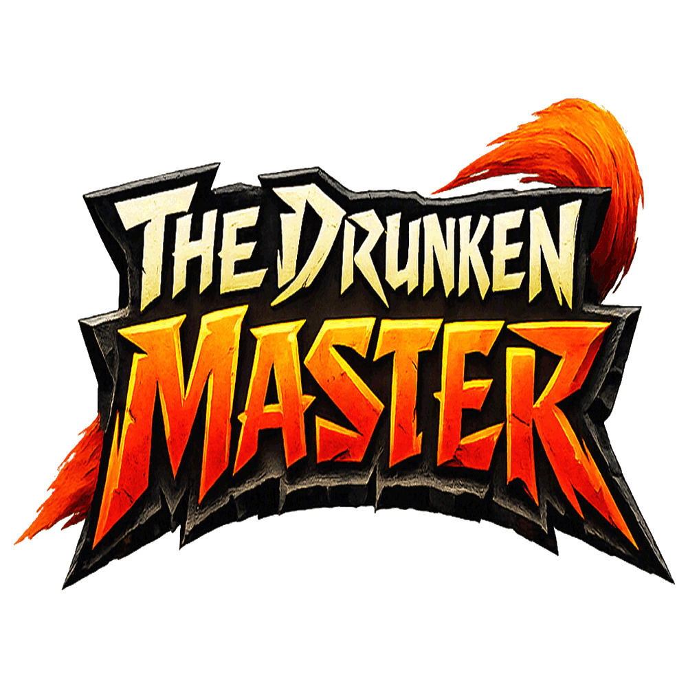
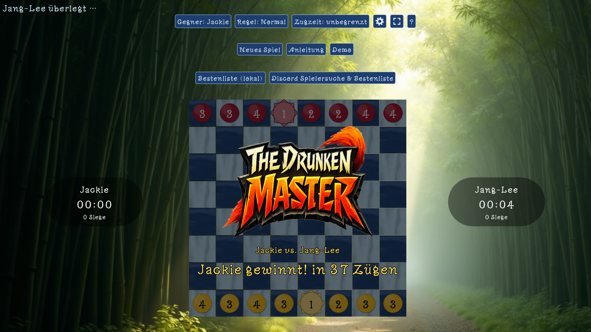

  

  <b>Zwei Kampfschulen des trunkenen Stils treffen sich zum Wettkampf, um den Meister der Meister zu küren.</b> 
  Ein taktisches Brettspiel für Windows - gegen den Computer, zu zweit an einem Rechner oder online.

  <a href="https://github.com/Yakobo1970/TheDrunkenMaster/releases/latest"><b>⬇ Neueste Version herunterladen</b></a>
  &nbsp;·&nbsp;
  <a href="https://discord.gg/pdyCU7R5uA"><b>Discord-Server</b></a>

## Worum geht's?

*The Drunken Master* ist ein eigenständiges digitales Brettspiel, inspiriert von einem
Magnetbrettspiel aus den 1980er Jahren, bei dem sich die Zahl auf jedem Stein bei jedem
Zug wie von selbst änderte. Der Name ist eine Verbeugung vor den torkelnden, aber
gefährlichen Kung-Fu-Filmen der 70er: kurze, unscheinbare Schritte - und trotzdem brandgefährlich.

### Die Regeln in Kürze

- **Ziel:** Schlage den gegnerischen Meister - oder reduziere den Gegner auf einen Schüler plus Meister.
- **Brett:** 8×8 Felder, jede Schule hat 7 Schüler und 1 Meister.
- **Die Zahl:** Jeder Stein zeigt, wie viele Felder er in diesem Zug ziehen *muss* (Schüler 1-4,
  Meister 1-2) - und die Zahl ändert sich mit dem Feld, auf dem er steht.
- **Ziehen:** nur gerade, höchstens einmal um 90° abbiegen, nichts überspringen.
- **Schlagen:** exakt auf einem gegnerischen Stein landen.
- **Drohende Niederlage:** Ein Angriff auf den Meister wird erst angesagt - schlagen darf man ihn
  eine Runde später. Wer angegriffen wird, muss reagieren.

Die vollständige Anleitung gibt es im Spiel unter **Anleitung**.

## Was steckt drin?

- **Vier Computergegner** von verspielt bis Langdenker: Dean, Jackie, Jang-Lee und Siu-Tin
- **Zwei Spieler an einem Rechner**
- **Online-Partien** über Discord - mit Spielersuche, Zufallsgegner, eigener Sprach-Lounge („Dojo“)
  pro Partie und Bestenliste auf dem Discord-Server
- **Demo-Modus:** die Computergegner spielen gegeneinander, wenn gerade niemand am Zug ist
- **Eigener Soundtrack** mit über 50 Titeln, Intro-Video und Sprachausgabe
- **Spieleigene Hintergründe** - Landschaften, Laternenfest, Kirschblüte, Tee-Zeremonie,
  Kung-Fu-Schulen - teils animiert, mit abschaltbarem Zoom-/Schwenkeffekt; alternativ eigene Bilder
- **Farbthemen**, Schriftarten, Deutsch / Englisch / Französisch
- **Update-Hinweis** im Spiel, sobald hier eine neue Version erscheint

## Installation

1. Unter [Releases](https://github.com/Yakobo1970/TheDrunkenMaster/releases/latest) die Datei
   `TheDrunkenMaster-Setup-x.y.z.exe` herunterladen.
2. Ausführen und dem Setup folgen.

Voraussetzung: Windows 10 oder 11 (64 Bit). Für Online-Partien ein Discord-Konto.

Windows SmartScreen kann beim ersten Start warnen, weil das Setup nicht signiert ist -
über „Weitere Informationen“ → „Trotzdem ausführen“ geht es weiter.

## Community

Fragen, Fehlermeldungen, Gegner gesucht? Komm auf den
**[Discord-Server](https://discord.gg/pdyCU7R5uA)** - dort laufen auch die Bestenlisten
und die Spielersuche.

---

## English

*The Drunken Master* is a tactical board game for Windows, inspired by a 1980s magnetic board
game whose piece numbers changed with every move. Play against four computer opponents, with two
players on one PC, or online via Discord. Capture the opposing Master - or reduce your opponent to
a single Student plus the Master.

[Download the latest release](https://github.com/Yakobo1970/TheDrunkenMaster/releases/latest) ·
[Join the Discord server](https://discord.gg/pdyCU7R5uA)

---

© Yakobo1970. Alle Rechte vorbehalten - Spiel, Musik, Bilder und Videos dürfen nicht ohne
Erlaubnis weiterverbreitet werden.
